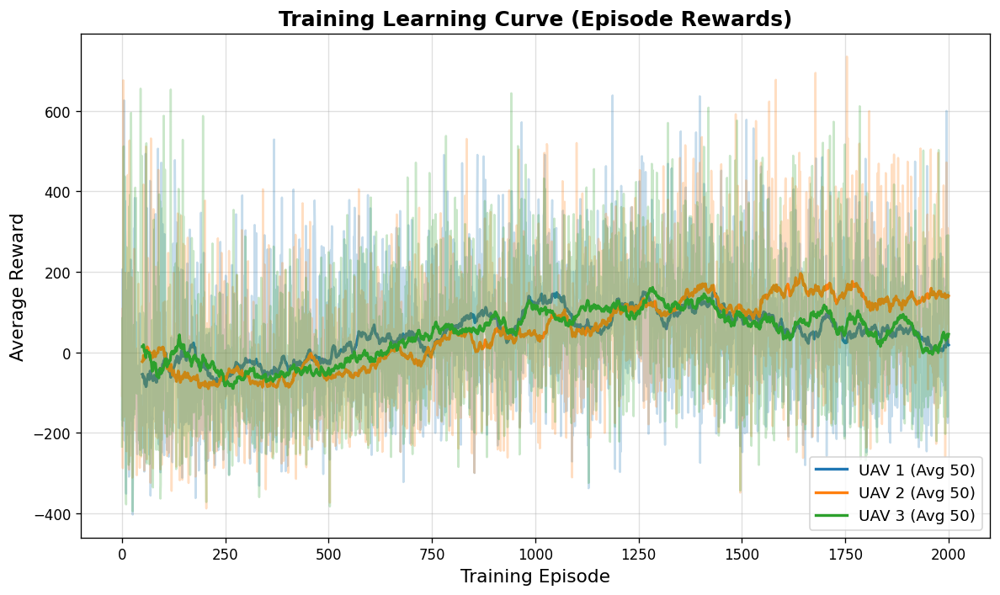
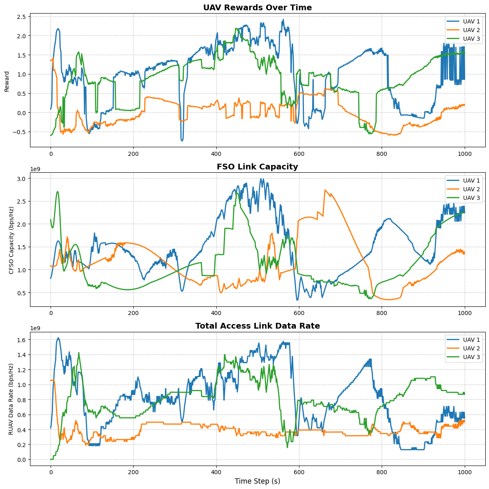
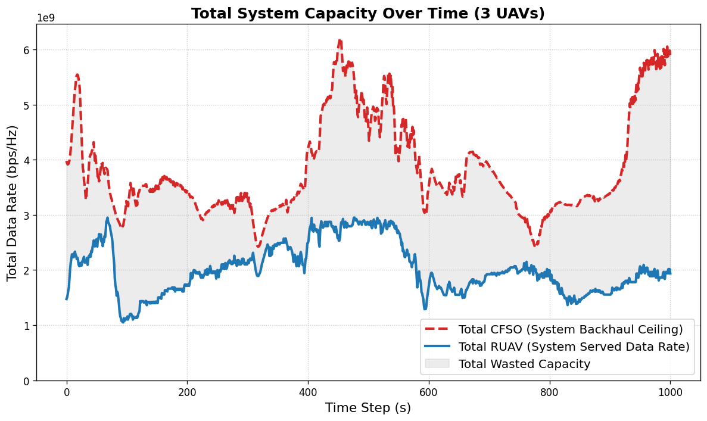
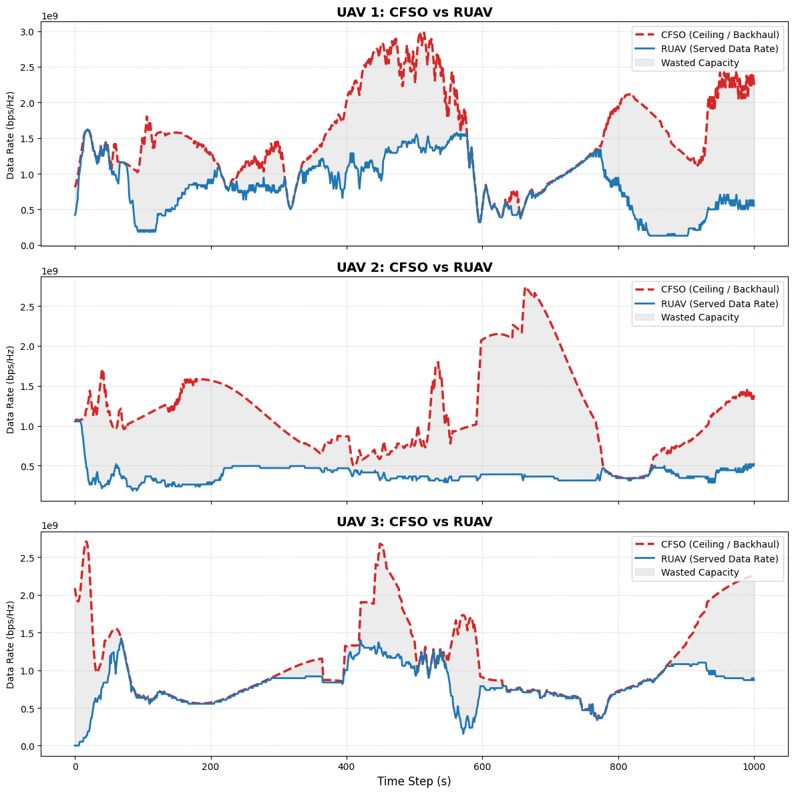

# Mobility_Aware_for_AGIN
Mobility-aware for Air-Ground Integrated Network (AGIN). Phương pháp nhận thức tính di động cho mạng truyền thông tích hợp bầu trời - mặt đất.

# Reference github: 
Repository này có tham khảo code từ link: https://github.com/minhnguyen27823/SAGIN-problem-optimization. Ngoài ra, chúng tôi đã tinh chỉnh một vài hàm để tối ưu việc huấn luyện trên GPU (CUDA). This code is adapted from link: https://github.com/minhnguyen27823/SAGIN-problem-optimization. Moreover, we refine some functions for faster training on GPU (CUDA)

# Some oustanding information/ results 
1. Kiến trúc về AGIN (AGIN Architecture)

2. Tệp train

a. Tệp train chính tại Channel_Modeling/train.py (test episode cuối)

b. Tệp train 1 phần tại Channel_Modeling/train.ipynb (test episode tại phần thưởng cao nhất)

3. Biểu đồ phần thưởng 2000 episode (Episode Reward)

4. Đánh giá mô hình qua kịch bản test (Test phase), chúng tôi chọn lựa tại episode 1250 vì cho phần thưởng cao nhất dựa trên biểu đồ phần thưởng

<video src="assets/trained_uav_policy.mp4" width="800" autoplay loop muted controls></video>

a. Clip Demo

b. Các kết quả đáng chú ý (Outstanding results)

- Kết quả test

- Tổng RUAV vs CFSO của 3 UAV

- So sánh RUAV và CFSO riêng cho từng UAV

