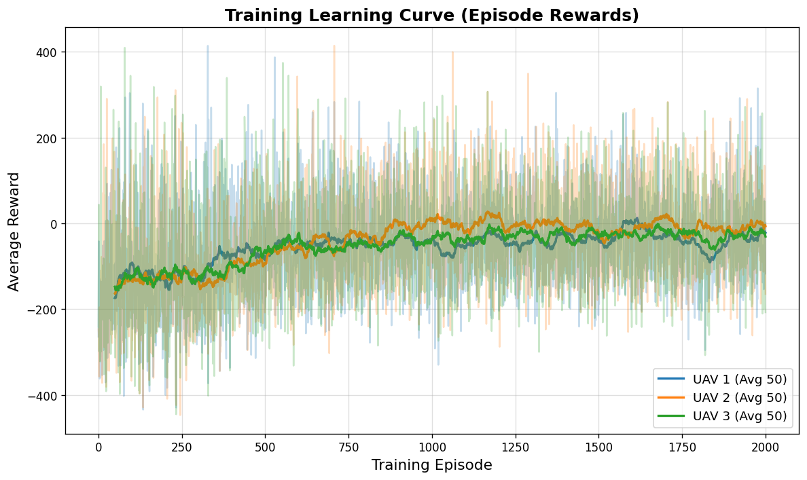
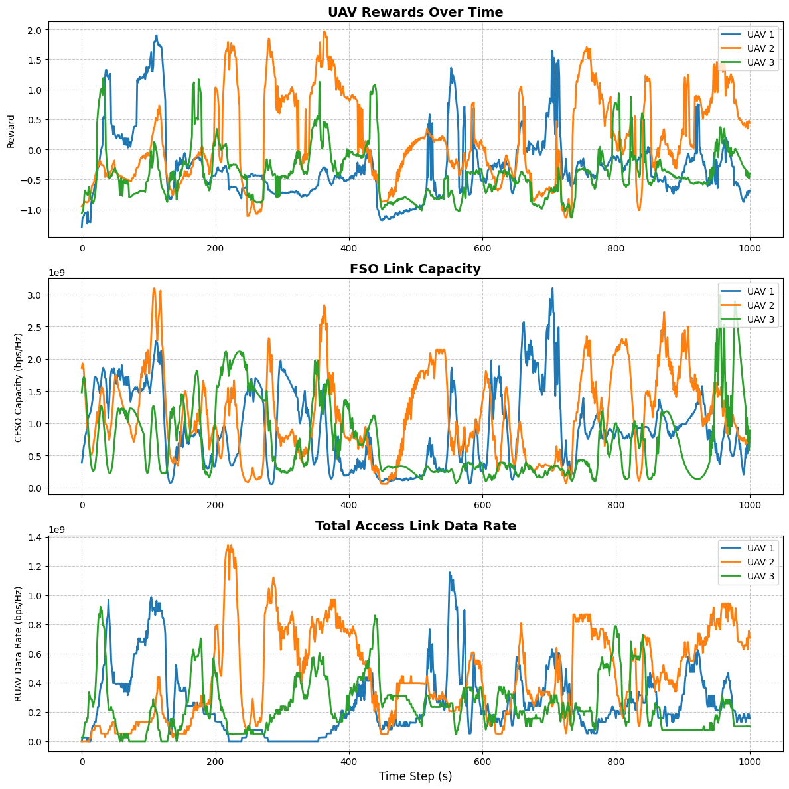
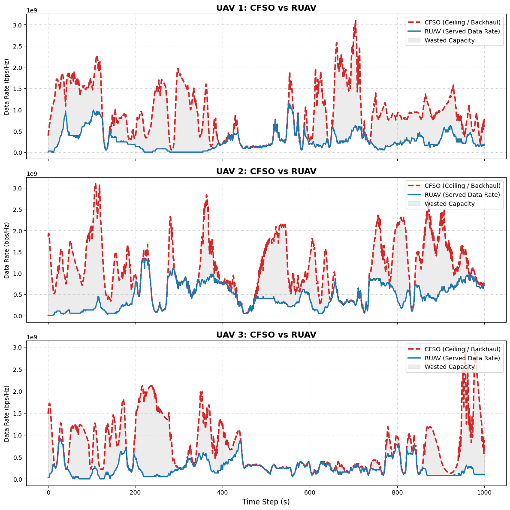

# Mobility_Aware_for_AGIN
Mobility-aware for Air-Ground Integrated Network (AGIN). Phương pháp nhận thức tính di động cho mạng truyền thông tích hợp bầu trời - mặt đất.

# Reference github: 
Repository này có tham khảo code từ link: https://github.com/minhnguyen27823/SAGIN-problem-optimization. Ngoài ra, chúng tôi đã tinh chỉnh một vài hàm để tối ưu việc huấn luyện trên GPU (CUDA). This code is adapted from link: https://github.com/minhnguyen27823/SAGIN-problem-optimization. Moreover, we refine some functions for faster training on GPU (CUDA)

# Some oustanding information/ results 
1. Kiến trúc về AGIN (AGIN Architecture)

2. Tệp train tại Channel_Modeling\train_update_obs_vec.py

3. Biểu đồ phần thưởng 2000 episode (Episode Reward)

4. Đánh giá mô hình qua kịch bản test (Test phase)
   
a. Clip Demo https://github.com/user-attachments/assets/5ac155b0-0060-44e8-8ef6-17da6cdd2ade

b. Các kết quả đáng chú ý (Outstanding results)

